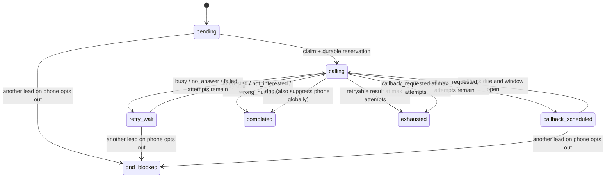

# Submission — Durable Campaign Dispatcher

## Design

This implementation uses a PostgreSQL-backed state machine. PostgreSQL is the durable source of truth for lead state, accepted attempts, idempotency keys, phone reservations, webhook fingerprints, and global DND suppression.

A provider request is never sent before its `CallAttempt` and `PhoneLock` are committed. The `request_id` is generated once and reused for every retry or recovery request. The provider's idempotency contract makes replaying that request safe.

### Lead lifecycle

`completed`, `exhausted`, and `dnd_blocked` are final states. A lead's own `dnd` disposition is `completed`; other unfinished leads sharing that phone become `dnd_blocked`.

## Scheduling and safety

- The provider's simulated clock is used for every dispatch decision.
- The clock is refreshed before every call claim; a batch never reuses a stale simulated timestamp.
- Campaign weekday/time windows and the global 09:00–21:00 IST regulatory window are checked before claiming.
- Callbacks have priority over retries, and retries have priority over fresh leads.
- A tenant row lock serializes claims; the tenant-wide active-call count enforces concurrency across campaigns.
- A unique `PhoneLock.phone` constraint prevents simultaneous calls to the same phone across campaigns.
- Global `PhoneSuppression` prevents future calls to a DND phone.
- A claim is not counted as an attempt. `Lead.attempts` advances only after provider acceptance is known, satisfying the accepted-call definition.

## Failure and recovery

- **503:** look up the `request_id`; if absent, retry the same request ID.
- **504/network timeout:** treat the outcome as ambiguous, look up the same request ID, and only re-submit with that same idempotency key if the provider reports it absent.
- **Webhook duplicates:** an atomic insert with a unique payload fingerprint makes duplicate delivery harmless.
- **Webhook lost:** active calls are reconciled against the provider's call lookup endpoint; the provider result is processed through the same webhook state transition.
- **Crash before provider POST:** a durable `prepared` attempt is found on restart and submitted with the same request ID.
- **Crash after provider acceptance:** restart looks up the prepared request ID, persists the call SID, then reconciles the result if it has ended.
- **Webhook before POST response:** webhook processing records the accepted attempt and call SID; later acceptance persistence is idempotent and does not reopen a completed attempt.

## Run and verify

See `README.md` for the local run commands. When all 200 leads are final, the dispatcher writes `final_state.csv`. The exporter checks every row against the provider's `/admin/leads` response and refuses to write a CSV if there are mismatches or incomplete leads.
